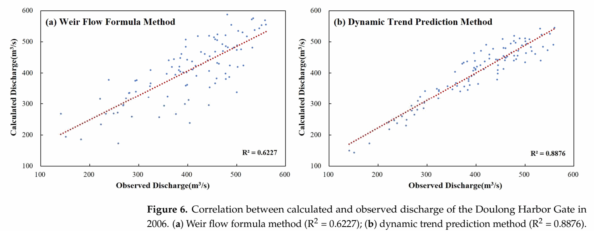
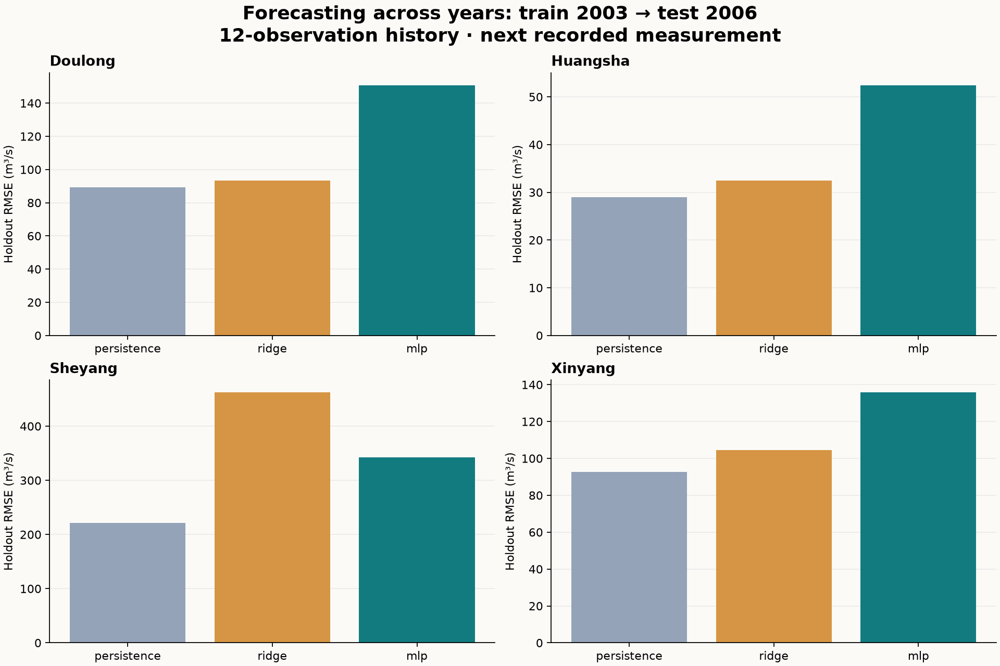

# Tidal Gate Forecasting & Discharge Estimation

**A research-to-code machine-learning case study by Tianshu Zhang.**  
Four tidal gates · published research · original result figures · runnable Python experiments

[中文说明](README.zh-CN.md) · [Published paper](https://doi.org/10.3390/w17091248) · [Method & evaluation](docs/METHOD.md) · [All paper figures](docs/PAPER_FIGURES.md) · [Historical figures](docs/ARCHIVED_FIGURES.md) · [New experiment figures](docs/EXPERIMENT_FIGURES.md)

## The engineering question

Coastal gates operate under changing upstream levels, downstream tides and gate conditions. Can a small neural network improve discharge estimates—and does a model that fits historical data also forecast unseen observations?

This repository turns the author's published research into a runnable Python portfolio project. It includes **1,309 monitoring records from four gates in 2003 and 2006**, source provenance, two explicit modelling tasks, simple baselines, figures and automated tests.

The original study used a proprietary neural-network training module. **This code is a new, AI-assisted implementation and extension, not the original software or a claim of reproducing the paper's reported accuracy.**

## Original published research

The original work studied dynamic discharge estimation/prediction at tidal harbor gates using a BP neural network within an existing engineering software module. The paper reports improvements over the traditional weir-flow formula. For example, its Figure 6 reports Doulong correlation-plot R² values of 0.6227 (weir formula) and 0.8876 (dynamic trend method); Figure 7 reports 0.1963 and 0.7547 for Xinyang. These are the paper's reported correlation statistics, not scores from this repository's Python benchmark.



**Complete visual record:** [all 10 published figures](docs/PAPER_FIGURES.md), [13 historical result/plot exports](docs/ARCHIVED_FIGURES.md), and [all 3 new Python experiment figures](docs/EXPERIMENT_FIGURES.md). Original figures retain their source captions; archived versions have separate provenance.

## New Python implementation

The following tasks, evaluation protocol and tables belong to a later, independent implementation. They do not establish how the original proprietary model would perform under the same protocol.

### Two tasks, clearly separated

| Task | Available at inference | Output | Purpose |
|---|---|---|---|
| Physics-guided estimation | Current upstream/downstream levels and two past flow observations | Current discharge via a learned coefficient and a weir formula | Demonstrate a causal, inspectable hybrid model |
| Rolling forecast | Previous 12 observations of levels/flow, with elapsed-time gaps | Discharge at the next recorded observation | Test the user's rolling-prediction interpretation as a separate extension |

The forecasting window is **12 observations, not 12 hours**. Sampling is irregular. Forecasting inputs never include the target discharge, target water levels or the realized next sampling interval. The hybrid estimator has current water-level measurements available; its results are **not advance-forecast performance**.

## What I contributed

For the original research, I carried out data preparation, feature construction, parameter experiments, analysis and preparation of the paper and associated patent materials, starting from my supervisor's research concept. Model training used the company's existing software module.

This portfolio adds a Python implementation, explicit data contracts, chronological evaluation, baseline comparisons and repeatable tests. AI assisted with code and documentation development. Authorship of the original training software is not claimed.

## Run it

Python 3.11+ (tested on 3.12):

```bash
python -m venv .venv
# Windows: .venv\Scripts\activate
# macOS/Linux: source .venv/bin/activate
python -m pip install -e ".[dev]"
python -m pytest -q
tidal-gate benchmark
python -m tidal_gate.hybrid
```

No access to the proprietary software is required. The CSV data needed for both experiments is included. The first command writes forecasting models under `results/models/`; these generated binary files are not committed.

Predict using a saved forecasting model and a 12-record history:

```bash
tidal-gate predict --model results/models/doulong_mlp.joblib --history data/example_history.csv
```

Only load model files that you trust. `joblib` models can execute code during loading.

## Evaluation of the new Python experiments

- Fit on **2003**. Select hyperparameters on the last 20% of eligible 2003 windows, purging overlapping training histories. Refit on 2003 only.
- Hold out **2006** until scoring; no random split across neighboring time samples.
- Fit feature/target scalers on training data only. Keep model weights frozen while observed history advances.
- Compare with persistence, regularized linear regression, a train-only constant coefficient and a previous-coefficient baseline, as appropriate to each task.
- In this new cross-year experiment, the 12-observation MLP has higher RMSE than persistence at all four gates. The new hybrid estimator improves over a fixed coefficient at all four gates, but has lower RMSE than discharge persistence only at Doulong. These findings concern this implementation and evaluation, not the original paper model.

**What is persistence?** It predicts the next discharge by repeating the latest observed discharge: Q̂(next) = Q(latest). It needs no training. Slowly changing flow can make this a competitive short-horizon reference; a neural network is not guaranteed to beat it. A fair comparison requires the same targets, information availability and test observations.

### Hybrid estimation: 2006 holdout RMSE (m³/s)

| Gate | Eligible test rows | Fixed coefficient | Last discharge | Hybrid neural network |
|---|---:|---:|---:|---:|
| Doulong | 90 | 62.20 | 77.78 | 39.21 |
| Huangsha | 100 | 124.67 | 25.51 | 39.33 |
| Sheyang | 54 | 346.44 | 224.82 | 233.25 |
| Xinyang | 95 | 200.96 | 78.14 | 104.49 |

Lower is better. The numbers in this table are **new benchmark results**, not the paper's reported metrics. See [hybrid results](results/HYBRID_RESULTS.md) and [forecasting results](results/RESULTS.md) for all models, sample coverage, MAE and R². The two tasks use different eligible samples and should not be directly ranked against each other.



## Inspect the work

- [`src/tidal_gate/`](src/tidal_gate/): cleaning, causal features, model selection, evaluation and inference.
- [`data/`](data/): observations, geometry, schema and source-file hashes.
- [`tests/`](tests/): future-information isolation, window alignment, missing records and physical-factor checks.
- [`results/`](results/): full prediction tables, metrics, exclusion log, validation selections and run configuration.
- [`docs/SOURCE_AUDIT.md`](docs/SOURCE_AUDIT.md): how archived training materials differ from the new implementation.
- [Complete figure galleries](docs/PAPER_FIGURES.md): original publication, historical exports and new experiment outputs, with [source metadata](assets/figure-provenance.json).

## Research context and limits

The associated study is Zhang et al. (2025), *Research on Dynamic Trend Prediction Method for Flow Discharge Through Harbor Gates in Tidal Reaches*, Water 17(9), 1248. [DOI](https://doi.org/10.3390/w17091248). Associated patent: [CN119578220B](https://patents.google.com/patent/CN119578220B/en).

This small, retrospective dataset cannot establish performance at new gates or under unseen operating policies. Fixed geometry does not capture all changing gate openings. A 24-hour gap rule defines sample eligibility, not a known operational event boundary. There is no deployment claim or guaranteed lead time. Unpublished manuscript drafts, review correspondence and proprietary model files are not redistributed. Published figure excerpts and author-supplied historical plots are included with source labels.

Data are supplied from the author's archive with the author's permission for this portfolio. No blanket license is asserted for the original dataset, paper, patent or proprietary software; see [rights and provenance](docs/RIGHTS.md).
