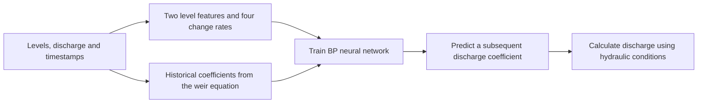
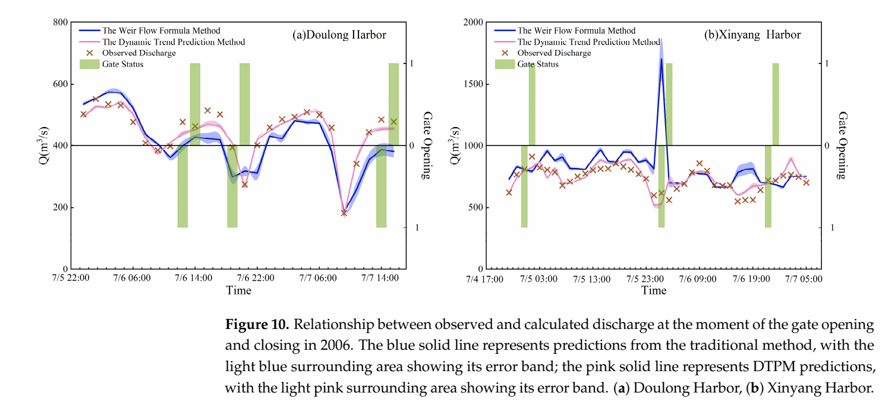

# Dynamic Trend Prediction of Discharge Through Tidal Harbor Gates

**Enriching limited hydrological observations with temporal-change features, learning a dynamic discharge coefficient with a BP neural network, and evaluating performance during gate operations.**

[中文](README.zh-CN.md) · [Paper](https://doi.org/10.3390/w17091248) · [Patent publication](https://patents.google.com/patent/CN119578220A/en) · [Method](docs/METHOD.md) · [Detailed results](docs/PUBLISHED_RESULTS.md) · [Figure gallery](docs/PAPER_FIGURES.md)

This research portfolio presents Tianshu Zhang's first-author Water paper (2025) and its associated patent method. The study uses water-level and discharge observations from 2003 and 2006 at four tidal harbor gates in Jiangsu, China: Sheyang River, Huangsha, Doulong and Xinyang.

## Engineering question

Tidal backwater and gate operation produce a changing relationship between water levels and discharge. Similar upstream and downstream levels can occur under different flow conditions. The study adds temporal-change information to the available observations, learns a dynamic submerged-discharge coefficient, and uses that coefficient in the weir-flow equation.

## From observations to six inputs

The measured variables are timestamp t, upstream level Zu, downstream level Zd and discharge Q. Time supports the calculation of rates of change; observed discharge supports both the discharge-rate feature and the coefficient target.

| Network input | Information represented |
|---|---|
| $Z_u$ | Upstream water-level condition |
| $Z_d$ | Downstream water-level condition |
| $\partial Z_u/\partial t$ | Upstream level trend |
| $\partial Z_d/\partial t$ | Downstream level trend |
| $\partial(Z_u-Z_d)/\partial t$ | Change in hydraulic head difference |
| $\partial Q/\partial t$ | Discharge trend |

These features combine hydraulic state with its temporal evolution using the existing measurements. Rates require actual elapsed times and consistent units. See paper §3.2 and Tables 2–3.

The network predicts the submerged-discharge coefficient. The final discharge calculation is:

$$
\hat Q=\hat\phi B H_s\sqrt{2g(Z_u-Z_d)},\qquad H_s=Z_d-Z_0
$$

B is the total gate-opening width, Z0 the sill elevation and g gravitational acceleration. The Doulong example uses B = 80 m, Z0 = −3 m and g = 9.8 m/s². Historical observed discharge provides coefficient targets; the paper pairs features with a subsequent coefficient. Discharge calculation also requires water levels and opening geometry for the target time.

## Network configuration

The study uses a **6–5–1 BP network**. Settings below are reported in §3.2 and Table 4.

| Setting | Reported value |
|---|---|
| Input / hidden / output neurons | 6 / 5 / 1 |
| Activation | tanh for hidden/output layers in the text; Table 4 lists “Double Sigmoid Cutoff Function” |
| Training method | High-Precision Processing Method |
| Connection rate | 1.0 |
| Learning rate | 0.7 |
| Training coefficient precision | 0.001 |
| Maximum training iterations | 10,000 |
| Momentum | 0.5 |

## Overall performance

The dynamic trend prediction method (DTPM) improves agreement with observed discharge relative to the traditional weir-flow method in the study dataset.

| Year | Mean correlation: traditional → DTPM | Mean relative error: traditional → DTPM |
|---|---|---|
| 2003 | 0.22 → 0.81 | 16.42% → 3.00% |
| 2006 | 0.35 → 0.82 | 9.73% → 1.32% |

Source: paper Table 7. Correlation coefficients in this table differ from the R² values in the figure below.

Five-fold cross-validation reports mean relative errors of **5.96%, 6.43%, 13.95% and 9.57%** at Doulong, Huangsha, Sheyang and Xinyang, respectively (Table 5). The paper reports cross-validation errors, standard deviations and plotted error bands; it does not specify confidence intervals at a stated confidence level. [Detailed results](docs/PUBLISHED_RESULTS.md) retain these distinctions.

## Gate opening and closing

The study separately examines operational transitions, where rapidly changing hydraulic conditions can produce large local errors despite reasonable overall agreement.

- Across the selected Table 8 events, maximum absolute relative error falls from **24.06% to 7.80%** at Doulong and from **176.88% to 28.28%** at Xinyang.
- At the particular Xinyang event with a traditional-method error of **176.88%**, DTPM gives an absolute relative error of **14.06%**.
- Under low water levels, Xinyang's mean relative error falls from **27.95% to 4.86%**. During slow gate opening, Doulong's falls from **12.49% to 2.68%** (Table 9).

Not every individual transition improves. All 12 event samples and the four operational scenarios are included in the [result tables](docs/PUBLISHED_RESULTS.md).

## Applying the approach

For engineers and researchers who have water-level/discharge records and access to a trainable neural-network model, the study offers a practical feature-design and evaluation workflow:

1. Extract physically meaningful trends from existing time-stamped measurements.
2. Learn a time-varying coefficient connected to a hydraulic equation.
3. Evaluate overall behavior and operational transitions separately.

The reported network settings are a starting configuration for this case. Transfer to another gate requires training and validation against its own observations, sampling resolution and operating conditions.

## Research materials

- [Method](docs/METHOD.md): inputs, coefficient target, configuration and application steps.
- [Results](docs/PUBLISHED_RESULTS.md): overall, cross-validation, event and scenario results.
- [All 10 published figures](docs/PAPER_FIGURES.md) and [historical result exports](docs/ARCHIVED_FIGURES.md).
- [Observation data and dictionary](data/README.md).
- [Paper](https://doi.org/10.3390/w17091248) and [associated patent publication CN119578220A](https://patents.google.com/patent/CN119578220A/en).

Research work encompasses observation preparation, feature construction, parameter experiments, result analysis and preparation of publication and patent materials. See [CITATION.cff](CITATION.cff) for citation information and [RIGHTS](docs/RIGHTS.md) for material-use information.
