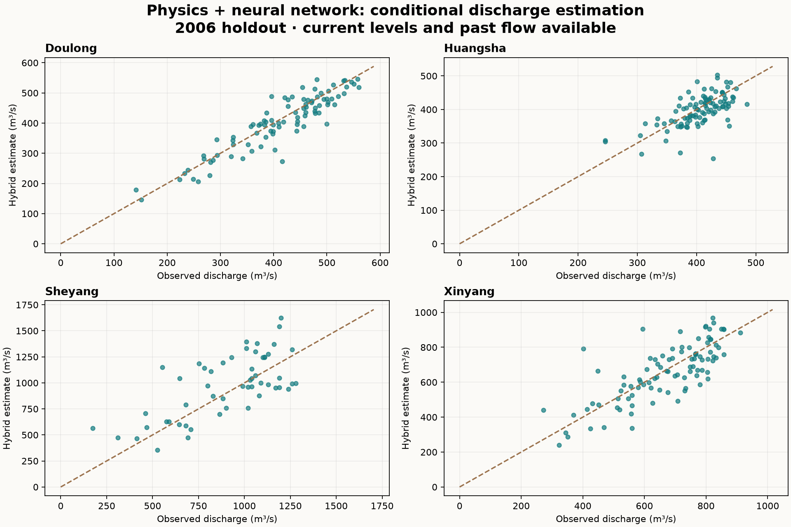

# 潮汐港闸流量：从论文到可运行的机器学习作品

[English](README.md) · [方法说明](docs/METHOD.md) · [论文全部图](docs/PAPER_FIGURES.md) · [历史结果图](docs/ARCHIVED_FIGURES.md) · [新增实验图](docs/EXPERIMENT_FIGURES.md)

这是张天舒基于第一作者 Water 论文及伴生专利整理的工程作品。它把真实观测、物理公式和神经网络放进一个可检查、可运行的 Python 项目中。

**四个港闸、两年观测、1,309 条记录。** 清理后保留 1,298 条；剔除的 11 条是用零值记录的开关闸占位行，原因保存在结果文件中。

## 原论文成果

原研究使用已有工程软件中的 BP 神经网络模块，研究潮汐港闸流量的动态变化，并与传统堰流公式进行比较。论文图 6 中，斗龙港相关图的 R² 从传统公式的 0.6227 提高到动态趋势法的 0.8876；图 7 中，新洋港对应为 0.1963 和 0.7547。这些是论文报告的相关性统计，不能与后面新增代码的测试误差直接比较。


完整图集包括 **10 幅论文原图、13 张历史结果与绘图版本、3 张新增代码结果图**。历史版本保留了 2007 年过程图、中英文版本及不同时间轴布局；各图均注明来源，不能把不同版本当作独立实验。

## 后续新增的代码实验

以下模型、数据划分和分数属于后来独立编写的 Python 实现，并不是原软件的重新运行。

### 这个实验解决什么问题？

潮汐和闸门运行使水位与流量关系不断变化。一个固定过流系数能否充分描述这些变化？加入神经网络后，是否真的优于简单方法？

本项目明确区分两项实验：

1. **物理公式＋神经网络估算。** 已知当前上下游水位、过去两次流量，预测当前过流系数，再代入堰流公式估算流量。输入不使用当前实测流量。这是有当前水位条件的估算，不是提前预报。
2. **12 步滚动预测。** 只用前 12 次观测，预测下一次观测流量。12 次不是 12 小时；未来的流量、水位和测流间隔都不作为输入。取得新观测后窗口前移，模型不重新训练。

原研究通过老师公司软件内置的神经网络模块训练。本仓库是**后续新增的公开实现与实验**，使用了 AI 辅助编程；不是原软件源码，也不声称已经复现论文中的精度。

## 怎么运行？

安装 Python 3.11 或更新版本，在项目目录运行：

```bash
python -m venv .venv
# Windows 激活：.venv\Scripts\activate
python -m pip install -e ".[dev]"
python -m pytest -q
tidal-gate benchmark
python -m tidal_gate.hybrid
```

两项实验均使用 2003 年训练，在 2003 年内部按时间划分验证集选择参数；2006 年独立测试。结果和图片写入 `results/`。

## 新增实验的结果应该怎样理解？

这里的“简单基准”指 **把最近一次实测流量直接当作下一次预测值**：例如最近测到 100 m³/s，就先预测下一次仍为 100 m³/s。它不需要训练，专业名称是持续性预测（persistence）。流量变化平缓时，这个方法可能有效；神经网络的结构更复杂，并不保证误差更小。

在本仓库新增的跨年份测试中，混合模型在四站均优于本次训练得到的固定系数基准，但仅在斗龙港优于最近一次流量；新写的 12 步预测模型在四站的 RMSE 都高于持续性预测。**这不等于原论文的软件模型不如简单基准：没有原模型按相同测试条件运行的结果，不能作出这个结论。**

这些新增实验结果与原论文结果分开展示。代码的输入、训练流程与评价设计尚不能视为原软件的等价复现；表现差异的原因也没有据此确定。



完整指标见 [物理模型实验](results/HYBRID_RESULTS.md) 和 [滚动预测实验](results/RESULTS.md)。

## 我的原始研究贡献

在导师提出研究思路后，独立完成数据整理、输入特征构建、参数试验、结果分析及论文和专利材料的研究实施。训练程序由已有软件提供。新仓库补充了可以直接检查和运行的代码、跨年份验证、简单基准及自动测试。

论文：[Water 2025, 17(9), 1248](https://doi.org/10.3390/w17091248)；相关专利：[CN119578220B](https://patents.google.com/patent/CN119578220B/en)。
