# 历史结果与绘图版本 / Archived results

[原论文完整图集](PAPER_FIGURES.md)

收录研究归档中找到的 13 张相关结果图，包括 2003/2006/2007 年过程图、开关闸比较的各个绘图版本，以及专利写作目录中的输入方案对比图。重复绘图版本也保留，按来源标识；它们不代表 13 项独立实验。

These are historical exports supplied by the author. Their exact software settings, train/test assignments and plotting transformations are not recovered from the images alone. The 2007 plots are archival illustrations; the observation dataset in this repository covers 2003 and 2006 only. Plot versions may use different axis origins and layouts. For final published conclusions, use the [paper figures](PAPER_FIGURES.md).

仅对展示副本进行格式转换和尺寸压缩，原文件未改动；没有重画曲线或重新计算指标。ZIP 内的同名过程图不重复存放。地图素材、DEM 和软件参数截图不属于结果图。

## 2003 年四闸流量过程对比

来源 / Source: `1-BP神经网络/画图/返图/2003bp.jpg`

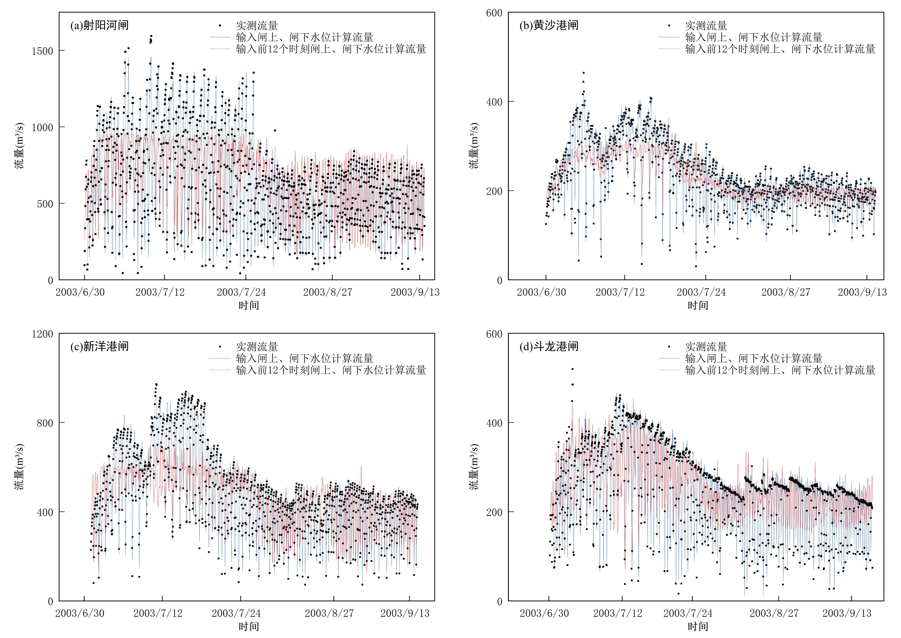

## 2006 年四闸流量过程对比

来源 / Source: `1-BP神经网络/画图/返图/2006bp.jpg`

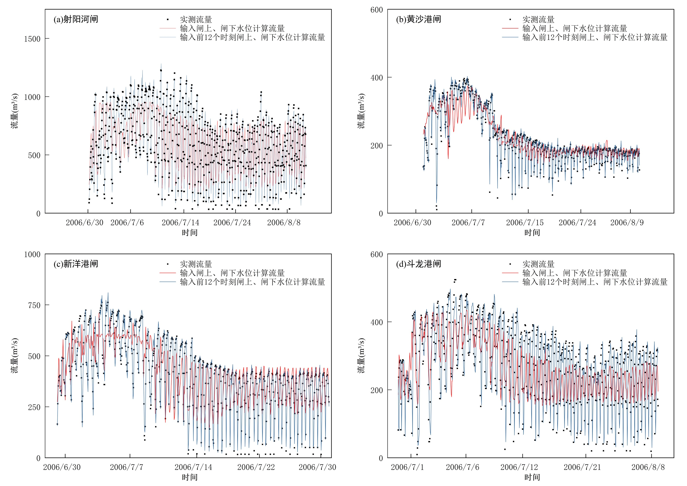

## 2007 年四闸流量过程对比

来源 / Source: `1-BP神经网络/画图/返图/2007bp.jpg`

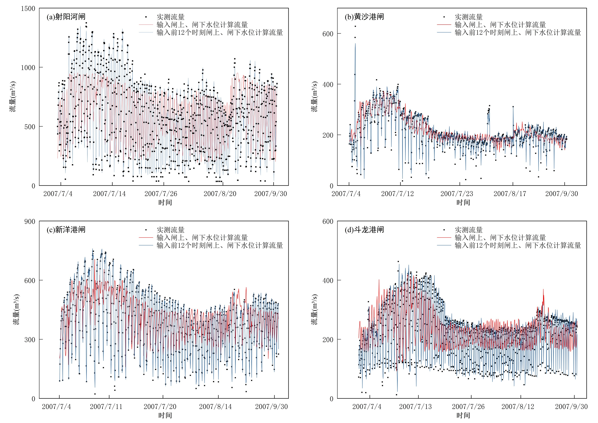

## Graph3.tif

来源 / Source: `5-转英文-Water/画图/origin画图/Graph3.tif`

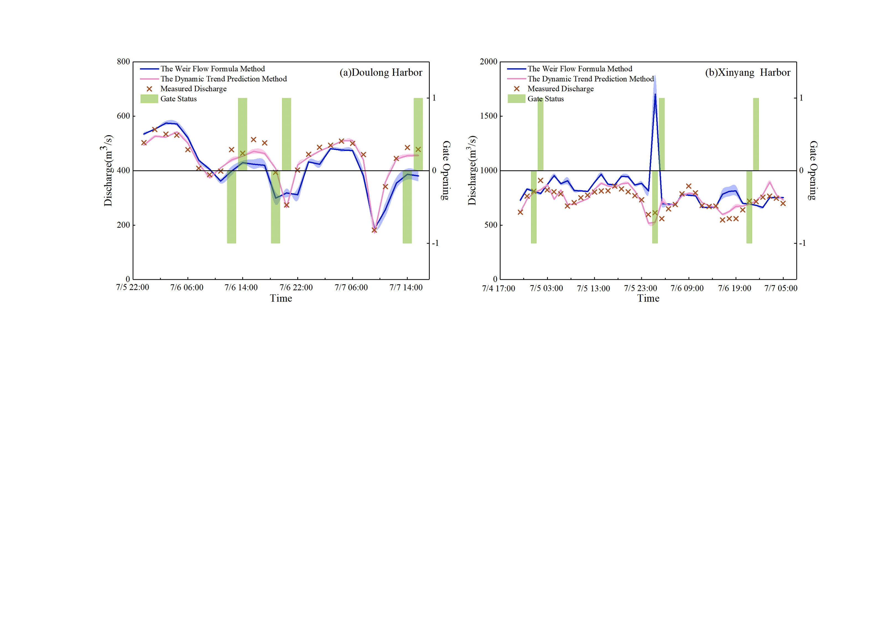

## 斗龙06加密时间轴.tif

来源 / Source: `5-转英文-Water/画图/origin画图/斗龙06加密时间轴.tif`

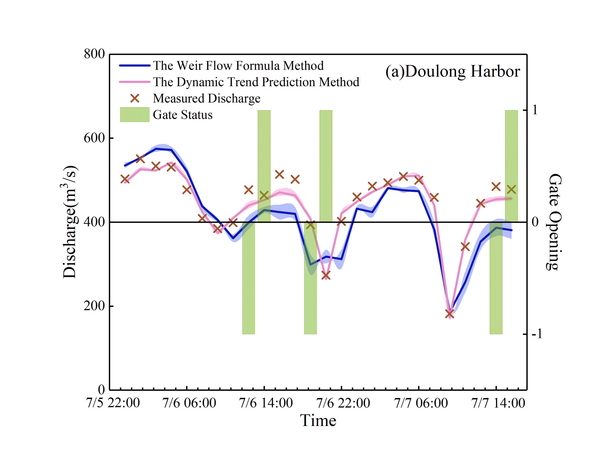

## 斗龙港06画图-中文.tif

来源 / Source: `5-转英文-Water/画图/origin画图/斗龙港06画图-中文.tif`

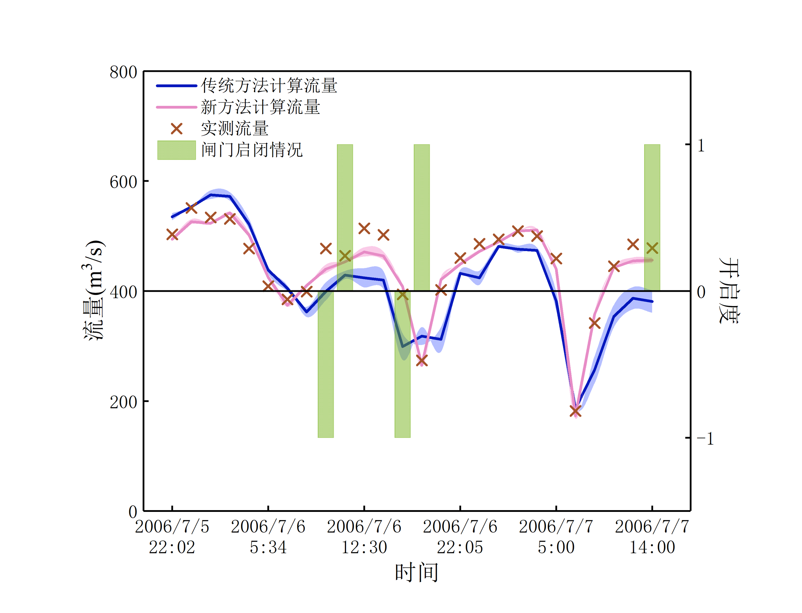

## 斗龙港06画图.tif

来源 / Source: `5-转英文-Water/画图/origin画图/斗龙港06画图.tif`

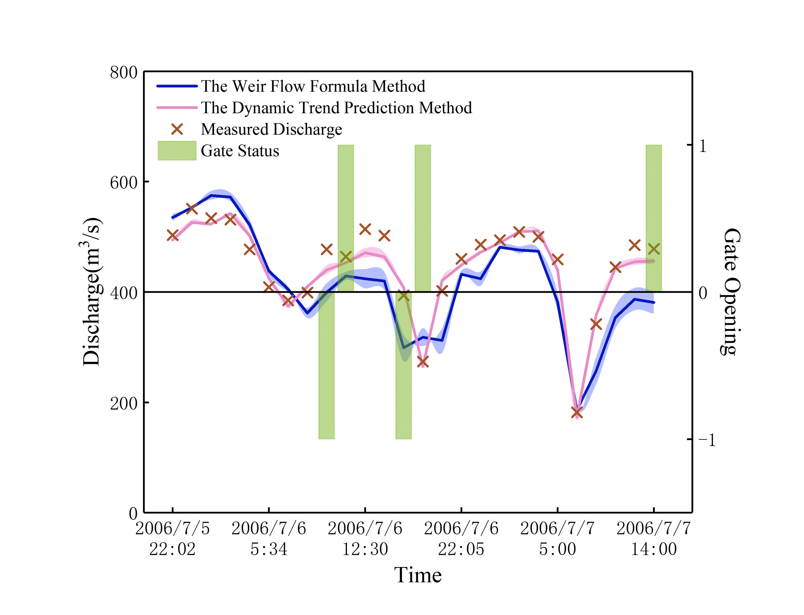

## 新洋06加密时间轴.tif

来源 / Source: `5-转英文-Water/画图/origin画图/新洋06加密时间轴.tif`

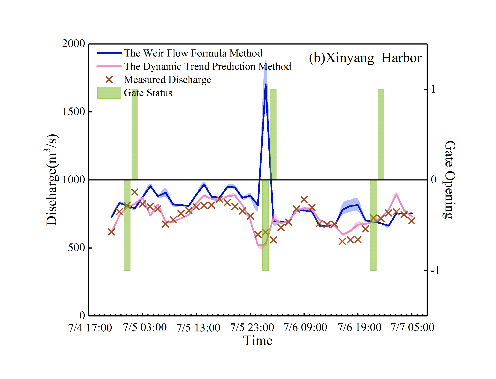

## 新洋港06画图-中文.tif

来源 / Source: `5-转英文-Water/画图/origin画图/新洋港06画图-中文.tif`

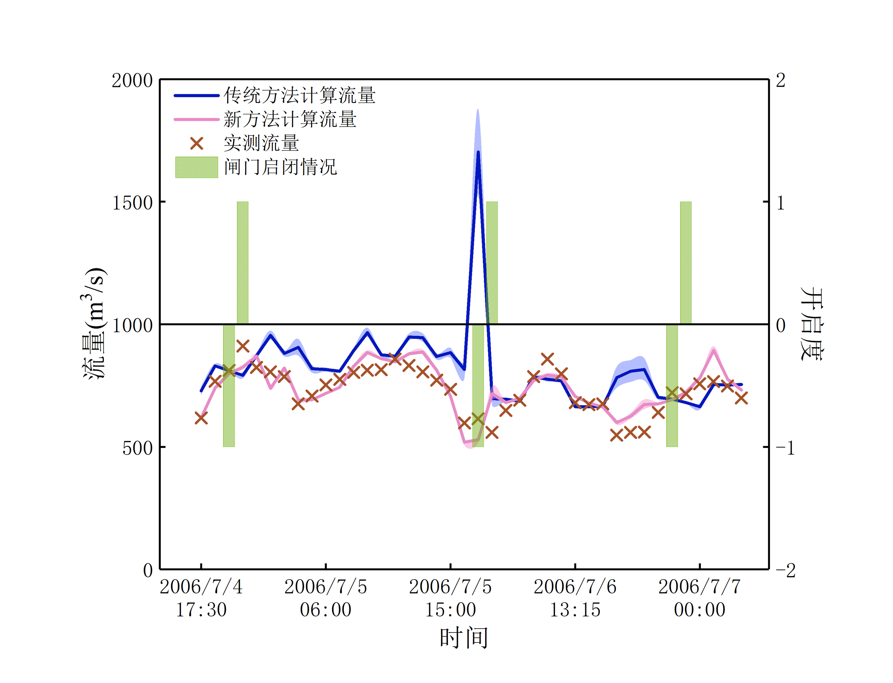

## 新洋港06画图.tif

来源 / Source: `5-转英文-Water/画图/origin画图/新洋港06画图.tif`

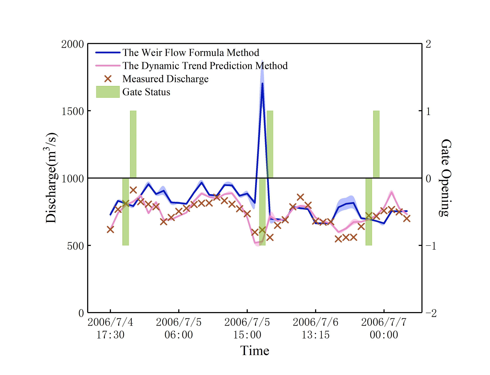

## 时间轴加密.jpg

来源 / Source: `5-转英文-Water/画图/origin画图/时间轴加密.jpg`

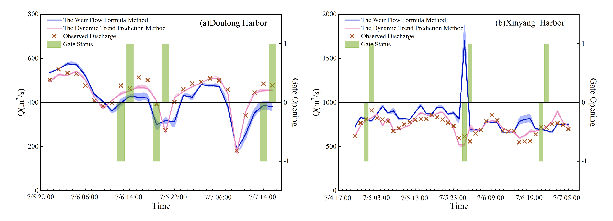

## 时间轴加密2.jpg

来源 / Source: `5-转英文-Water/画图/origin画图/时间轴加密2.jpg`

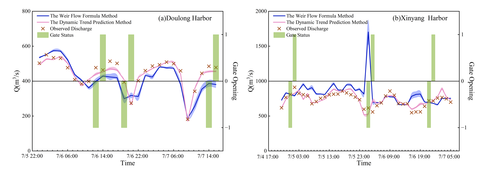

## 历史 12 时刻输入与当前水位输入对比

来源 / Source: `2-专利撰写/屏幕截图 2024-09-30 211310.jpg`

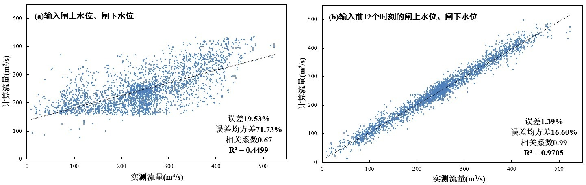
