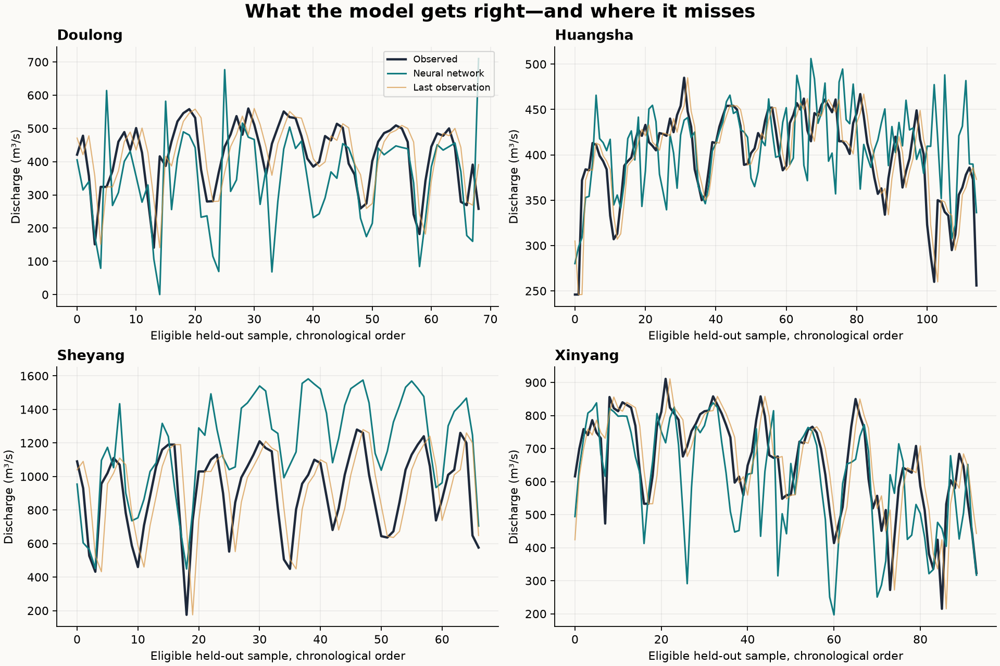

# 新增 Python 实验图 / New Python experiments

[原论文图集](PAPER_FIGURES.md) · [历史图集](ARCHIVED_FIGURES.md)

这三幅图来自本仓库新增代码，不是原软件输出，也不是论文精度的复现。训练划分、输入和评价方式见 [方法说明](METHOD.md)。

## 物理与神经网络结合的估算 / Hybrid estimation

## 12 步预测模型与基准误差 / Forecast error comparison

## 12 步预测的测试期过程线 / Holdout forecast traces

