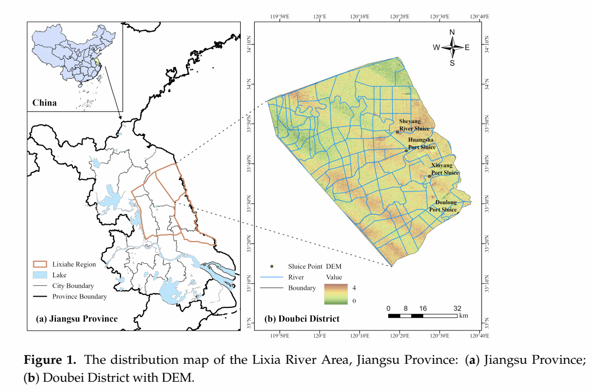
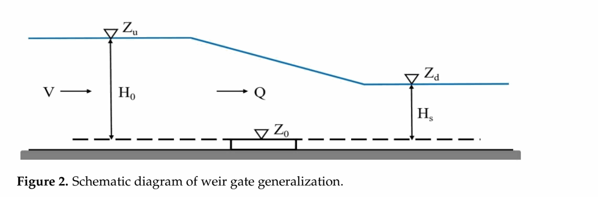
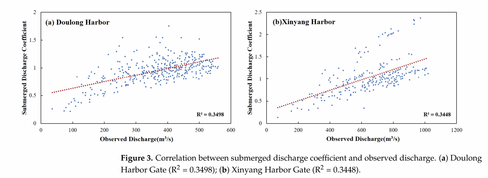
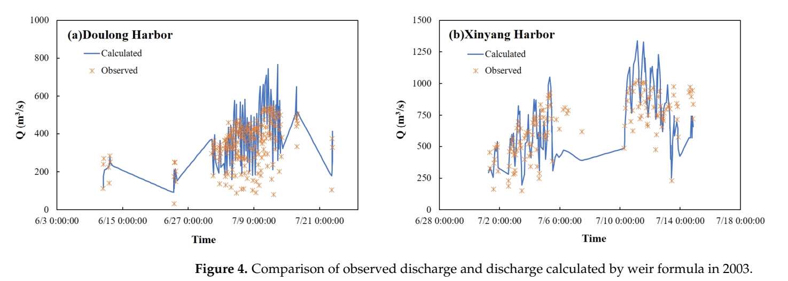
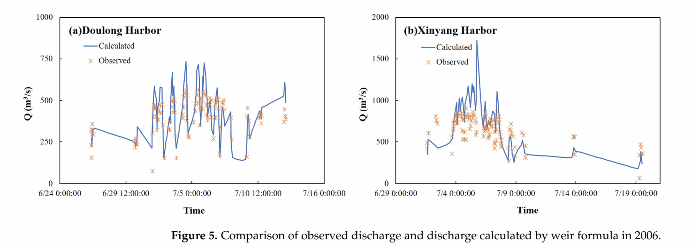
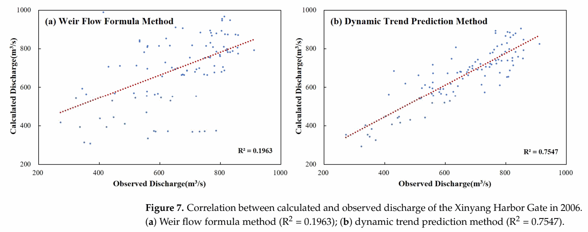
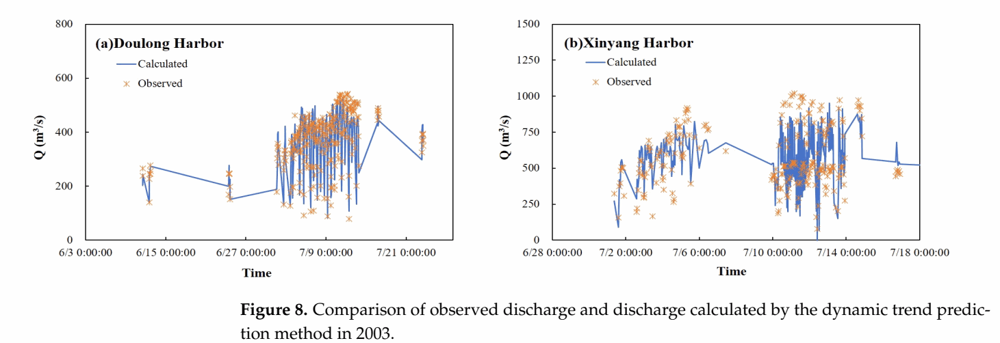
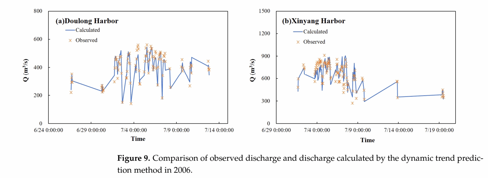

# 原论文完整图集 / Published paper figures

[返回项目 / Project](../README.md) · [历史结果图 / Archived figures](ARCHIVED_FIGURES.md) · [新增实验图 / New experiments](EXPERIMENT_FIGURES.md)

以下是作者提供的最终发表论文中的全部 10 幅图，按原图号排列，包括研究区、方法示意和结果。图像直接从论文渲染裁取，保留原图及图注，没有重新计算或改写数值。

Source: Zhang et al. (2025), *Research on Dynamic Trend Prediction Method for Flow Discharge Through Harbor Gates in Tidal Reaches*, Water 17(9), 1248. [DOI](https://doi.org/10.3390/w17091248). PDF page numbers below include the cover. These are the original published results, not the outputs of the new Python implementation.

论文图 6–7 比较动态趋势法与传统堰流公式；这与新增代码中“最近一次实测流量”基准的比较不同。论文中的相关性指标也不能直接替换成新增测试集上的误差指标。

## Figure 1 — 研究区与 DEM / Study area and DEM

PDF 第 5 页；论文第 4 页。

## Figure 2 — 堰闸概化 / Weir-gate schematic

PDF 第 5 页；论文第 4 页。

## Figure 3 — 淹没流量系数与实测流量 / Coefficient and observed discharge

PDF 第 9 页；论文第 8 页。

## Figure 4 — 2003 年传统公式流量过程 / Weir formula, 2003

PDF 第 9 页；论文第 8 页。

## Figure 5 — 2006 年传统公式流量过程 / Weir formula, 2006

PDF 第 10 页；论文第 9 页。

## Figure 6 — 斗龙港两种方法对比 / Doulong method comparison

PDF 第 11 页；论文第 10 页。

## Figure 7 — 新洋港两种方法对比 / Xinyang method comparison

PDF 第 11 页；论文第 10 页。

## Figure 8 — 2003 年动态趋势法流量过程 / DTPM, 2003

PDF 第 12 页；论文第 11 页。

## Figure 9 — 2006 年动态趋势法流量过程 / DTPM, 2006

PDF 第 12 页；论文第 11 页。

## Figure 10 — 开关闸时刻流量对比 / Gate opening and closing

PDF 第 13 页；论文第 12 页。

